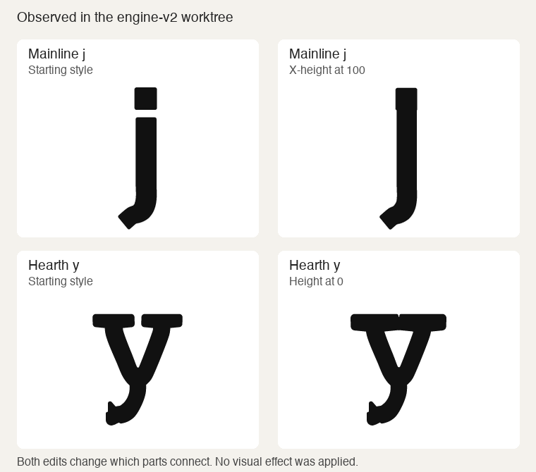
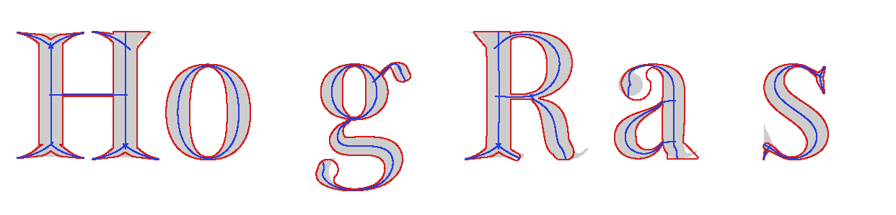

# Evidence for the TypeLab architecture proposal

Observed on October 24, 2026. Main was at `c2a121d`. The `engine-v2` worktree was based on that commit with substantial uncommitted changes. These observations describe that working tree, not a released migration. The investigation changed documentation and diagnostic artifacts only.

The user wants existing styles to remain legitimate, usable fonts as controls change them. The reported failures include separated components, height changes that break letters, and artifacts around tails.

## Height edits change the construction



These renders use the migration's actual `buildFont` output. Mainline's `j` dot touches its stem at `xHeight: 1`. Hearth's `y` closes across its top at `height: 0`. Each image is fitted for inspection; this is a comparison of shape, not absolute height.

The [height probe](evidence/heights.json) checked nine characters, `HhbgpRqyj`, in Mainline, Couture, and Hearth. It changed each of `height`, `xHeight`, `extenders`, and `descender` to 0 and 1 individually, for 216 cases. It found five changes in connected-piece or counter counts:

| Style | Letter | Change | Observed difference |
| --- | --- | --- | --- |
| Mainline | j | X-height 1 | Two pieces become one |
| Mainline | j | Extenders 0 | Two pieces become one |
| Couture | j | Extenders 0 | Two pieces become one |
| Hearth | y | Height 0 | One new counter |
| Hearth | j | Extenders 0 | Two pieces become one |

Only the Mainline x-height and Hearth height cases above were inspected visually. The other three are diagnostic findings. Counts alone miss kinks, ugly proportions, and changes in which particular parts connect. The 216-case sample does not establish a catalog-wide defect rate.

## The migration changes the starting drawings

The migration's existing `tools/fonts/convert/review.ts` compares original and reconstructed outlines at the card's starting settings. It scales the original to the engine's cap height and measures intersection over union of filled areas. The measurement includes positional differences and is not a typographic quality score.

| Source | Characters | Aggregate overlap |
| --- | --- | --- |
| Mainline | HogRas | 97.3% |
| Couture | HogRas | 92.6% |
| Hearth | iR | 92.4% |

Couture's `a` scores 0.86 individually; Hearth's `i` scores 0.87. The viewed overlays show changed terminals, serifs, and dot shape. The source format explains some unavoidable loss. [`SourceDot`](../../.tools/v2/engine/sources/fonts/types.ts) stores one scalar size. Hearth's original `i` dot is a 138 by 117 rectangle, which cannot be retained in that representation. Original Bézier contours are available in `fonts/`, but the new runtime reconstructs them from centerlines and widths.



The gray fill is the original Couture drawing, the red line is the reconstructed outline, and the blue line is the inferred centerline. These are starting settings, before an edit.

## Some migrated controls have no geometric effect

The control probe hashes final outline commands and advance at 0, 0.5, and 1. It loads the actual Mainline source through each checkout's `styleParams` helper.

| Control and letter | Distinct outputs on main | Distinct outputs in v2 |
| --- | --- | --- |
| Aperture, c | 3 | 1 |
| Dot size, i | 3 | 1 |
| Width, H | 3 | 3 |
| Weight, H | 3 | 3 |

The last two are positive controls. Distinct hashes establish a change, not whether the change looks good. Raw results are [main](evidence/controls-main.json) and [v2](evidence/controls-v2.json).

The migrated [`replay`](../../.tools/v2/engine/sources/fonts/letters.ts) does not apply aperture or dot size to these source glyphs. Sharing the stroke expander does not automatically give imported shapes the procedural alphabet's controls.

## Current cleanup can reverse a control or remove a feature

The [weight probe](evidence/weight-main.json) calls main's real [`evenWeight`](../../shared/engine/even-weight.ts) on deliberately small synthetic examples.

Two 100 by 500 stems separated by 30 units receive requested horizontal expansions of 15, 16, 17, and 20 units. Their measured expansions are 15, 14, 15, and 14. Increasing the request can reduce the applied expansion near the geometric limit.

A second example contains a stem and a separate 10 by 10 dot. The dot survives requests 0 and 0.04, then disappears at 0.06. The final speck filter runs after the function's topology check. It does not distinguish an original dot from an artifact.

These probes establish defects in the operation's contract. They do not establish how often those exact conditions occur in the supplied fonts.

## Other contracts affected by the representation

- The current engine's [`freeGlyph`](../../shared/engine/free-letters.ts) uses inferred anatomy, restyling, and outline offsets. Its point-edited letters use a different weight/deformation path in [`family-drawn.ts`](../../shared/engine/family-drawn.ts). A point edit therefore changes future control behavior.
- The migration's [`drawnLetter`](../../.tools/v2/engine/sources/drawn.ts) does not reshape point-edited letters under weight, width, or height. The Inspector and control-panel copy still promise those operations. New tests assert the frozen behavior. This is a product change, not evidence that the original capability survived.
- Both engines can replace an imported glyph with a generic procedural glyph when a form setting changes. V2 does this through `formChanged`, `fontGlyph`, and the fallback in [`buildFont`](../../.tools/v2/engine/font.ts).
- Stroke indices remain persistent edit IDs. Converted source strokes have no independent IDs. Both [`PARAMS_VERSION`](../../shared/params/clean.ts) declarations remain 7 despite changed geometry interpretation.
- [`CarryOffer`](../../client/components/CarryOffer.tsx) applies document edits from a React effect based on undo/history changes. Its search dependency on the undo index may stop detecting commits once the 200-entry buffer is full. This is a static finding that still needs a UI reproduction.
- [`isDirty`](../../client/state/editor.ts) excludes persistent history, although save includes it. Edits followed by undo may leave unsaved history without a leave warning. The intended persistence policy needs to be explicit.

## History supports preserving the selected style

Commit `a64124c` states that the selected TypeLab font supplies the letters the user shapes. Commit `0c33bb6` restored source fonts after `cc22301` removed them to make every control available. Commits `56711ec` and `6d9457b` specifically fixed point-edited letters that stopped following controls and family weights. These are recorded implementation intentions, not independent proof of successful outcomes.

## Repeat the observations

Run these sequentially from the main checkout with its installed dependencies:

```sh
node --max-old-space-size=512 --import tsx docs/architecture/probe.mjs . controls
node --max-old-space-size=512 --import tsx docs/architecture/probe.mjs . weight
node --max-old-space-size=512 --import tsx docs/architecture/probe.mjs .tools/v2 controls
node --max-old-space-size=512 --import tsx docs/architecture/probe.mjs .tools/v2 heights
```

From `.tools/v2`, the existing conversion review can reproduce the outline comparison:

```sh
node --max-old-space-size=512 --import tsx tools/fonts/convert/review.ts Couture --chars HogRas --cols 6 --scale 0.23 --out /tmp/couture-review.png
```

The existing renderer can reproduce the two pictured height failures. Omit `--set` for each starting style:

```sh
node --max-old-space-size=512 --import tsx tools/render.ts --style grotesque --free --text j --set xHeight=1 --size 150 --out /tmp/mainline-j.png
node --max-old-space-size=512 --import tsx tools/render.ts --style softslab --free --text y --set height=0 --size 150 --out /tmp/hearth-y.png
```

[Snapshot hashes](evidence/snapshot.json) identify the inspected source and engine files. Changes in the active migration may change these observations.

The proposal also draws on local source, tests, CLAUDE notes, and selected git history. No external issue, chat, production telemetry, or analytics records were available. No full application test suite, exhaustive style sweep, browser interaction suite, or export round trip was run. No production behavior was changed by this investigation.
