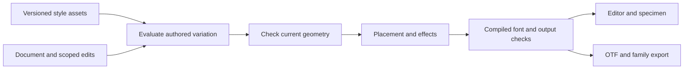

# A workable foundation for TypeLab

Treat each starting style as an authored font design with defined ways to change. Keep its original outlines, add designed variations and named relationships between parts, and offer controls within the ranges that design supports.

The main engine change should be the representation of editable styles. The editor, library, accounts, saving, and export workflow contain useful work worth keeping. This proposal does not implement the replacement engine.

## Why another general stroke engine will not resolve this

The product promise is to start with an existing style and reshape it into another legitimate, usable font. Both engines have been trying to infer the missing design information from finished outlines. Main does that during deformation. The migration does much of it beforehand, then replaces the outlines with reconstructed strokes.

The migration has a cleaner package structure, but its stored representation loses information about the original drawing. It also lacks explicit facts such as which stroke a tail joins, which small shape is an intentional dot, and how far two parts may move before they collide.

The investigation reproduced several consequences:

- Mainline's `j` dot touches its stem at maximum x-height in v2.
- Hearth's `y` closes across the top at minimum height in v2.
- Six reconstructed Couture letters have 92.6% filled-area overlap with their originals at starting settings. Their terminals and serifs visibly change before an edit.
- Mainline's aperture and dot-size controls do nothing in the tested v2 cases, although they change output on main.
- A small direct probe of main's weight operation makes increasing requests produce less expansion near a geometric limit. A separate probe loses an existing dot in the final cleanup.

The [evidence report](evidence.md) includes images, runnable probes, limitations, and source references. These are focused reproductions, not a claim that every style or every control has been audited.

## What a letter should contain

An editable letter needs an exact drawing and information about how that drawing may change:

| Data | Purpose |
| --- | --- |
| Original curves and spacing | Reproduce the selected style exactly at its starting settings |
| Compatible authored variations | Define good lighter, heavier, shorter, taller, or wider versions |
| Stable point and feature IDs | Keep edits attached to the same point, tail, dot, or crossbar |
| Named relationships | Keep intended joins attached, dots separate, openings open, and tail departures smooth |
| Supported controls and joint ranges | Define which combinations this style can produce |
| Source and interpretation versions | Reopen saved work with the same meaning |

For example, a `j` has a body, a dot, and a required gap between them. Its x-height operation must account for all three. A `y` has an opening between its upper arms that a height adjustment must preserve. An `R` tail has an attachment and departure direction, as well as a tip that can move.

Automatic skeleton analysis can suggest those features. A source author accepts or corrects them once. Runtime rendering consumes that reviewed information and never guesses a different join host after a slider moves.

The exact starting outline remains available throughout. Correcting a defective source drawing creates a reviewed source revision. A general repair pass does not silently rewrite it on every render.

## Use authored variations for the main shape controls

Start with compatible masters for weight, width, and height changes. A master is a designed version of the same glyph, with corresponding points and curves. Intermediate settings interpolate those coordinates and spacing. This is an established type-design approach, with explicit compatibility requirements for points, paths, components, and anchors. [Glyphs outline compatibility](https://handbook.glyphsapp.com/interpolation/outline-compatibility/).

The neutral master is the original style, normalized once into documented font units without refitting its curves. With no local edits and neutral settings, return it directly. Effects and export rounding are separate projections.

Define the allowed combinations together. A tall, heavy letter may need a different design than the sum of an independently tall letter and an independently heavy letter. Use interaction masters where necessary and exclude combinations that have not been authored. Do not extrapolate beyond the supported region. The source format can use the axes, sources, and instance concepts already represented by [fontTools designspace](https://fonttools.readthedocs.io/en/latest/designspaceLib/index.html).

Add reviewed local motions for inspector controls such as a crossbar, dot, or tail. These reference stable source points and named relationships. They are small, explicit operations. They do not require converting the whole alphabet into strokes.

Compatible masters alone are insufficient. Interpolation can still close an opening or produce an ugly curve. Review rendered combinations, then check the actual requested geometry for self-intersections, named connections, clearances, and valid metrics. Define those measurements on boundary curves with an explicit approximation tolerance; a few witness points or aggregate contour counts are insufficient. Sampling provides regression evidence; it is not proof of every intermediate setting. Human review establishes whether the result retains the style's character.

This requires font-specific authoring. Most current styles have one drawn master, so good variations cannot be recovered just by reorganizing code. Begin with a small number of styles and controls. Expand once their behavior is dependable.

## Give each control an honest contract

| Kind of edit | Implementation and behavior |
| --- | --- |
| Rotation, translation, spacing, slant | Explicit geometric or layout transforms with documented metrics behavior |
| Weight, width, x-height, ascenders, descenders | Authored variations and reviewed supported combinations |
| Dot, crossbar, terminal, tail details | Authored feature motions, with named attachment and clearance rules |
| Single-storey a, different g, other letter forms | A style-owned alternate with its own variation data |
| Pixel, stencil, slice, roughness, outline fills | Explicit effects after base-letter construction, each with its own validity rules |
| Blocks, grids, arcs, generated letters | Keep their purpose-built construction and compile to the common outline result |

The panel and direct-manipulation handles read the same capability result from the engine. Remove the separate assumptions in UI filtering, copy, and render-probe reach detection. A control has a target, a current value, a supported range, and a reason when unavailable.

For a whole-font operation, support means all affected letters, including those outside the preview text. Preserve existing override inheritance: a local override stays local, and Reset removes it so the letter follows the font again.

A slider range is the supported interval through the current combination of other controls. Keep stored values in stable design coordinates. Do not silently renormalize a saved value when another axis changes. If a request exceeds a limit, keep the last accepted outline and identify the limiting feature. Do not independently clamp each letter, which would make the font inconsistent.

Use conservative authored ranges so limits are exceptional during ordinary editing. Run evaluation in a worker, stamp requests with document revision and gesture sequence, and discard stale results. Before committing, validate every affected glyph. Cache unaffected glyphs by source revision and edit revision. Measure response time on a representative font before promising a drag-performance target.

## Preserve the editing workflow

Points mode edits the letter's ink before effects. A normal point move updates the corresponding point across compatible masters. Applying the same delta to each corresponding point moves the interpolated point by that delta while retaining the weight and height variation. More specific optical corrections can use per-master adjustments. Splitting a curve uses the same curve parameter across masters.

Point edits and part overrides can invalidate previously reviewed geometry. Recheck the current combination when accepting the edit and every subsequent evaluated setting. Structural edits that remove bindings need a compatible replacement or an explicit custom-glyph operation with its reduced capabilities shown before committing. A small point move must never silently switch engines or freeze that letter at one weight.

Store form-specific edits against the form they modify. Switching back restores those edits. A missing alternate is unavailable; it never substitutes a generic letter from another design.

Move document mutation into a controller with explicit commands and gesture IDs. React displays state and dispatches commands. One drag produces one undo step. Matching-letter propagation receives the original edit and revision; it cannot overwrite a newer edit when an asynchronous search finishes. Preserve the current opt-in behavior for rough or mirrored matches.

Undo and persistent History remain distinct. Include persistent History in the durable revision, so new history after undo cannot disappear behind a clean-document indicator. Preserve the existing save-in-flight protection by marking only the revision actually sent to the server as saved.

## Keep the engine boundary small



Four modules own the important decisions:

- `source-program` owns exact outlines, master correspondence, feature IDs, relationships, authored ranges, and source loading.
- `evaluate` owns scoped values, variation evaluation, local motions, geometry checks, and per-glyph caching. It returns a result or a specific limitation.
- `document` owns commands, overrides, gestures, undo, durable History, save revisions, and legacy conversion.
- `output` owns placement, effects, layout metrics, family instances, and export projection. Existing geometry utilities remain internal here and in evaluation.

Both browser and server load the same immutable source digest. Missing source data produces a loading or missing-source result. It does not briefly draw a generic fallback and then change the font when data arrives.

One evaluated font feeds preview and export. OTF coordinate rounding and spacing rules are explicit, checked output behavior. Export preview uses that same projection. Effects that deliberately split ink have an effect-specific contract; they do not disable checks on the underlying letter. Never remove a tiny source feature merely because it resembles an artifact.

The [TypeScript contract sketch](contract.ts) shows the proposed boundaries. It is declaration-only and is not imported by the app. A slider caller would use the controller this way:

```ts
const gesture = editor.beginGesture();
const result = await editor.preview(gesture, {
	kind: 'set',
	setting: { target: { kind: 'font' }, control: selectedControl, value },
});
if (result.kind === 'accepted') {
	draw(result.edit.preview);
	editor.commit(result.edit);
} else {
	showLimit(result.issues);
}
```

During a drag, repeat `preview` from the gesture's immutable starting document. Commit only its latest accepted result on release. The caller does not coordinate skeleton extraction, repair, or source substitution.

Saving captures `editor.serialize()` and marks that captured revision saved after the request succeeds. Export calls `compileFont(document, 'otf')` and serializes a ready result. Server code opens the same saved document through `openDesign` first, resolving its pinned sources.

## Salvage the useful migration work

Keep v2's `engine/` boundary, lazy glyph builds, separation of placement and effects, pre-effect ink, offline analysis tools, and original-versus-converted review tool. Keep the existing editor shell, source drawings, library, accounts, override rules, history behavior, and shared family/export path.

Replace the stroke-only representation of existing styles, inferred join hosts, positional persistent IDs, unconditional morphological repair, and generic form fallback. Treat medial-axis conversion as an authoring assistant or an explicit approximation tool. It does not define the selected style's authoritative drawing.

The choice of a geometry library is secondary to these contracts. V2's Clipper wrapper can remain useful for polygon effects. Curve operations must document their error tolerance and preserve source curves when no operation requires approximation. Replacing a boolean library cannot supply missing typographic intent.

## Migrate in units that prove the behavior

1. **Establish source identity.** Load the exact Mainline source with stable IDs and a content digest. Prove that the card, editor, neutral document, saved/reopened document, and projected export agree. Build the authoring review tool around that comparison.
2. **Prove the difficult transformations.** Author weight and height variation on `HhbgpRqyjci` in Mainline and Hearth, with Couture as a high-contrast stress case. Include combined weight and height changes. The known `j` and `y` failures must be prevented by both authored geometry and named checks. Inspect joins, tails, counters, and spacing at text sizes. Compare this result against a small authored-component prototype before scaling the representation.
3. **Prove the editor round trip.** Move a point, change weight and height again, make a letter override, reset, undo/redo, propagate an edit, save/load, and export a supported family. The same letter must keep responding coherently throughout. Exercise history beyond its 200-step undo limit and stale asynchronous results.
4. **Finish one usable style.** Extend the approved controls across its complete supported alphabet, figures, punctuation, and requested accented forms. Check actual OTF readback and layout. Ship that complete style before converting the catalog.
5. **Expand style by style.** Reuse authored feature groups where appropriate. Keep optical review and behavior checks for each style. Add a control only after its intended operation and supported combinations exist.

Keep old designs on an isolated, pinned main renderer with the source assets available at migration time. Record that interpretation explicitly. Converting a saved design creates a new version with a before/after comparison and a map of old part edits to new feature IDs. An unmapped edit prevents silent conversion. Preserve the old snapshot and histories.

The legacy branch returns an editor session backed by an adapter to the existing editor actions and pinned engine. It supports the old editing, undo, save, and export workflow. Its capabilities retain the old control meanings; source-only commands that cannot be translated are unavailable. The new geometry guarantees apply to converted source programs. Keeping an old interpretation preserves its limitations as well as its appearance.

Some historical source bytes may already be unavailable. A source name alone cannot recover an earlier drawing; record that limitation instead of inventing exact compatibility. Do not run the dirty v2 reinterpretation over every saved version-7 design.

## What would demonstrate that this works

Use exact neutral-source checks, named geometry invariants, and user-action tests together. A changed path hash only proves that something changed. An unchanged golden only proves agreement with its accepted baseline.

For every offered control, check the intended measurement in the expected direction, reversibility to neutral, meaningful intermediate steps, and relevant multi-control combinations. A join must remain the same join; a counter must remain the same counter. Then inspect approved renders for optical quality. Check the final output again after any operation or quantization that can change those relationships.

Do not accept a new golden merely because a rewrite produced it. Keep the starting source and deliberately approved variations as independent references. Random sweeps should produce minimal reproducible cases and fail the verification command on genuine violations.

This plan does not guarantee good typography from arbitrary edits. It gives the program a defined set of useful changes, preserves the design information needed to make them, and gives failures a specific meaning. The first two implementation milestones should determine whether the authored variation approach is affordable before the rest of the migration proceeds.

The [design decision](decision.md) records the alternative architectures, comparison, and remaining risks.
